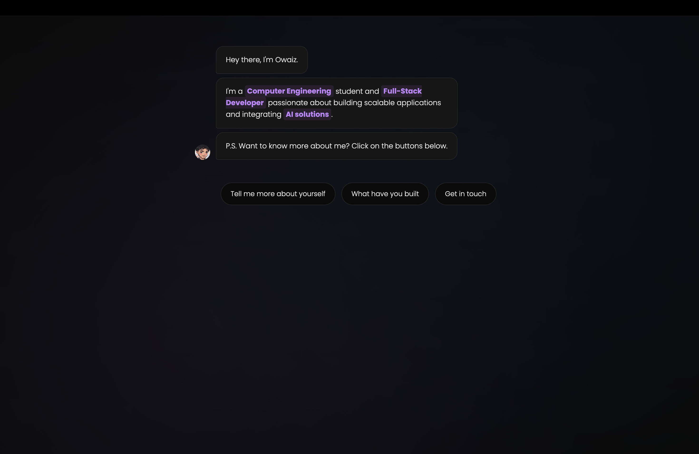
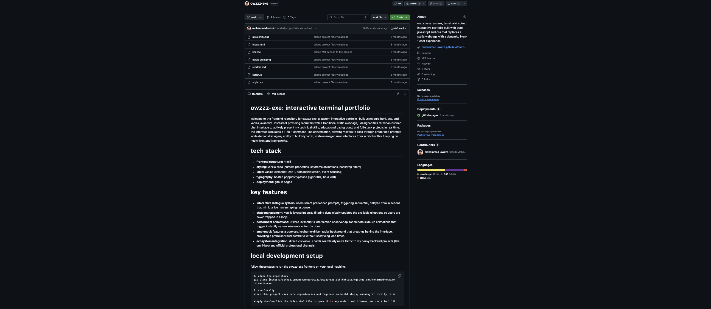
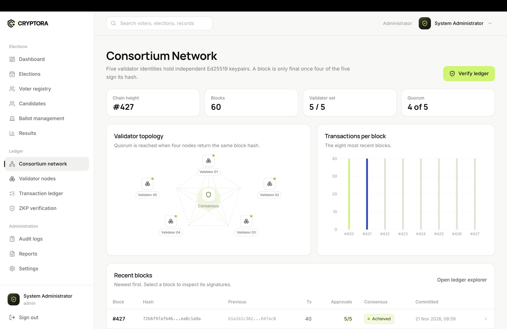
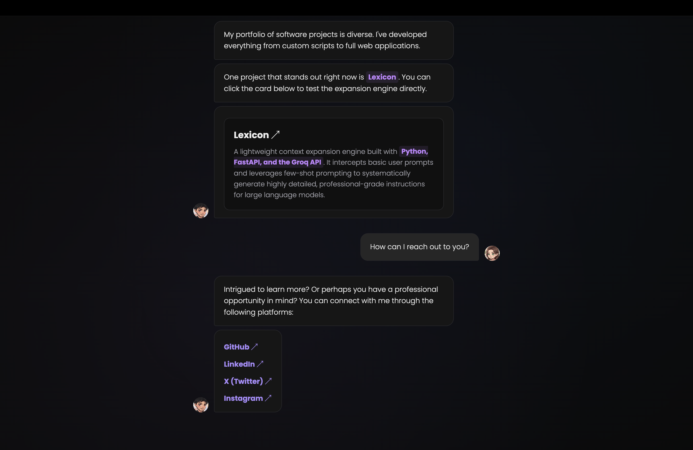

# cryptora: secure privacy-preserving e-voting platform

**A secure, privacy-preserving e-voting platform built on a consortium blockchain and zero-knowledge proofs.**

cryptora separates three questions that conventional e-voting systems conflate:

| question | mechanism |
| --- | --- |
| who is allowed to vote? | poseidon merkle tree of voter commitments, published as a root on the ledger |
| what was submitted? | a paillier ciphertext vector, encrypted in the voter's browser |
| has anything been altered? | an append-only block chain signed by five validators with a 4-of-5 quorum |

nothing in the system stores a plaintext ballot, and no api response joins a voter identity to a candidate selection.

---

## tech stack

- **frontend:** react 18 + typescript + vite + tailwind css
- **backend:** express 4 + typescript
- **database:** sqlite via prisma (deterministic seed)
- **cryptography:** poseidon merkle trees, paillier homomorphic encryption, ed25519 signatures, groth16 zero-knowledge proofs (snarkjs + circom)
- **consortium blockchain:** five validators with 4-of-5 quorum, append-only signed blocks
- **deployment:** node.js production build served from a single process

---

## key features

- **three-question separation:** who may vote, what was submitted, and whether anything was altered are answered independently
- **browser-side proving:** voters generate groth16 proofs locally and encrypt one-hot ballot vectors with paillier before submission
- **single-use nullifiers:** each voter can cast at most one ballot per election, enforced on-chain
- **validator quorum:** four of five independent validators must sign before a block is appended
- **deterministic seed:** a repeatable demonstration dataset (12,480 voter commitments, 8 elections, 8,526 ballots) is reproducible on every machine
- **audit & reporting:** auditor workspace, ledger explorer, election tallies, and receipt codes for every cast ballot

---

## screenshots

| screenshot 1 | screenshot 2 |
| --- | --- |
|  |  |
|  |  |
|  | |

to capture: run `npm run dev`, open <http://localhost:5173>, and take screenshots of each view.

---

## local development setup

follow these steps to run cryptora on your local machine.

```bash
1. clone the repository
git clone https://github.com/mohammed-owzzz/cryptora.git
cd cryptora

2. install dependencies
npm install

3. generate the zero-knowledge proof artifacts (optional)
npm run setup

4. initialise the database
npm run db:push

5. seed the demonstration dataset
npm run seed

6. start the development servers
npm run dev
```

open <http://localhost:5173>. the api runs on :4000 and the vite dev server on :5173.

to run the production bundle instead:

```bash
npm run build
npm start
```

then open <http://localhost:4000>.

demo credentials:

| role | identifier | credential |
| --- | --- | --- |
| administrator | admin@cryptora.demo | admin@1234! |
| voter | voter-2026-0042 (alex morgan) | voter@1234! |
| auditor | jordan@cryptora.demo + auditor id aud-2026-001 | auditor@1234! |

other scripts:

- `npm test` — vitest cryptography suite (hashing, merkle membership, paillier tallying, ed25519)
- `npm run seed` — reset the demonstration dataset at any time

---

## architecture at a glance

```
client/            react 18 + typescript + vite + tailwind
  src/pages        public site, three role workspaces, the ballot flow
  src/lib          api client, auth context, browser-side prover + paillier
  public/zkp       eligibility.wasm + eligibility_final.zkey (groth16)
server/            express 4 + typescript
  routes           auth, public, admin, voter, auditor
  lib              merkle, paillier, ed25519, chain, zkp, reports, audit, stats
prisma/            schema + deterministic seed (sqlite)
circuits/          eligibility.circom (depth-13 poseidon membership + nullifier)
docs/              architecture, blockchain, zkp, security, demo guide
tests/             vitest cryptography suite
```

---

## honest limitations

these are properties of this build, stated plainly rather than hidden:

1. **the consortium is simulated.** five validators are independent database identities with genuine ed25519 keypairs and independent validation routines, but they run inside one node process rather than on five institutional machines. there is no network partition, gossip or byzantine fault simulation.
2. **tally key custody is single-key.** each election's paillier private key is stored on the server. a production system would split it across independent trustees with threshold decryption.
3. **no ballot well-formedness circuit.** the circuit proves eligibility and nullifier derivation, not that the encrypted vector is exactly one-hot. that property is approximated by server-side length checks and the ciphertext commitment, not by a range proof.
4. **witness delivery.** the credential secret is derived server-side and delivered to the voter's own browser over the authenticated session. there is no hardware token, wallet or national e-id integration.
5. **sqlite + prisma db push.** the schema is applied by push rather than versioned migrations, which is appropriate for a single-machine demonstration.
6. **proof artifacts are ~5 mb.** the first ballot generates a proof in a few seconds while snarkjs loads the wasm and zkey; server-side verification takes roughly 100–200 ms.

---

## license

mit
